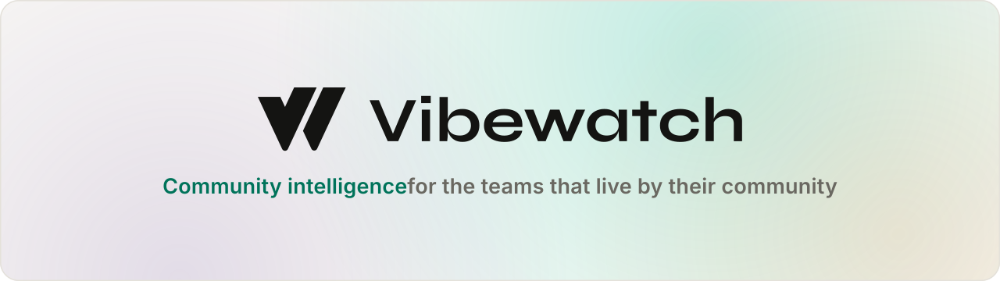

  

   
   

  
  
  

 

**Vibewatch is community intelligence for the teams that live by their community** — crypto projects, public companies, and consumer brands. We aggregate sentiment across every platform your community calls home, including private Discord and Telegram channels, and turn it into a weekly report your whole team can act on.

The difference: narrative reports written by AI, not another dashboard to check — with scoring that learns from your team's corrections over time.

   
  
   
  <a href="https://vibewatch.io">vibewatch.io</a> &nbsp;·&nbsp; <a href="mailto:hello@vibewatch.io">hello@vibewatch.io</a>

