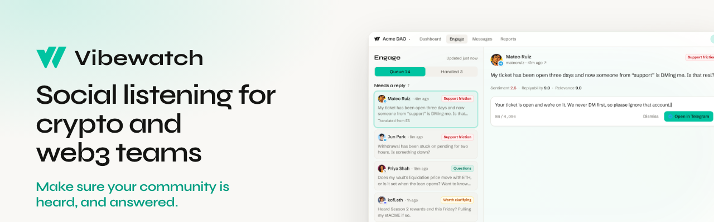

  

   
   

  
  
  

 

**Vibewatch reads your Discord, Telegram, X and more, shows which inbound messages need a reply, and writes a weekly report for your whole team.**

Discord and Telegram coverage comes from inside the servers and channels where your community actually talks. Vibewatch never drafts or posts a reply. Someone on your team writes each one and sends it from their own account.

   
  
   
  <a href="https://vibewatch.io">vibewatch.io</a> &nbsp;·&nbsp; <a href="mailto:hello@vibewatch.io">hello@vibewatch.io</a>

